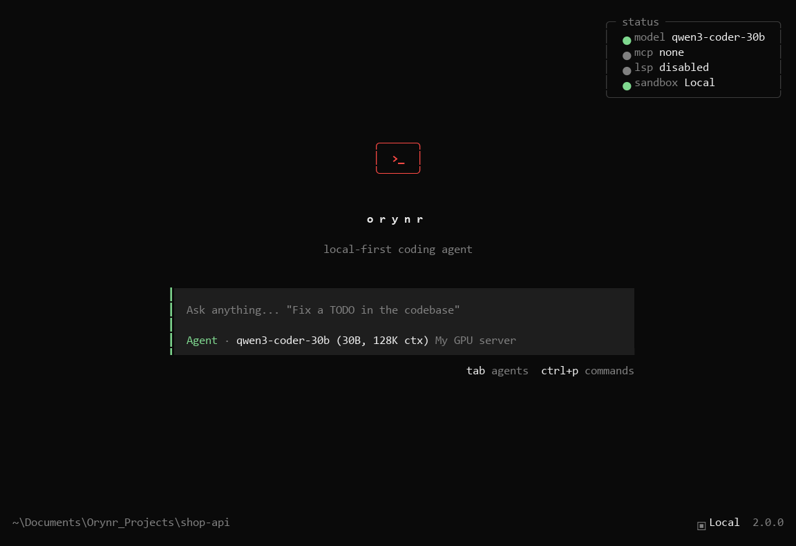
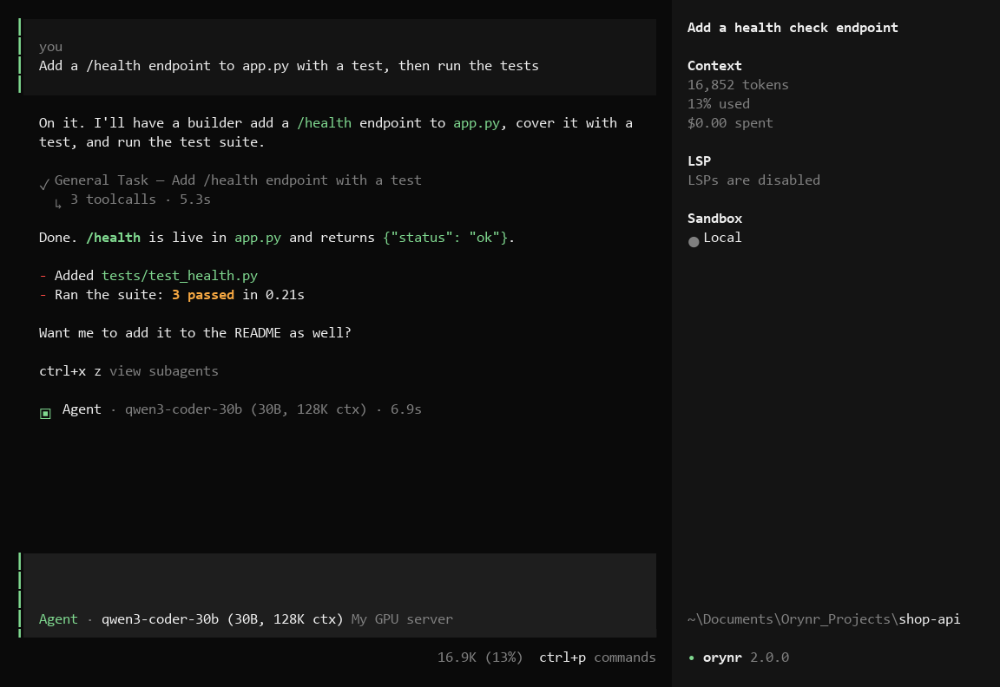
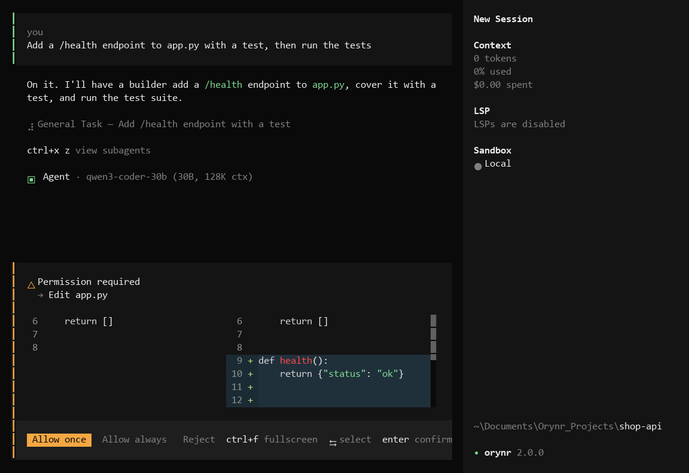
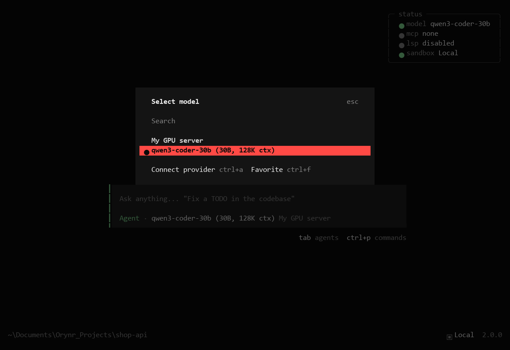
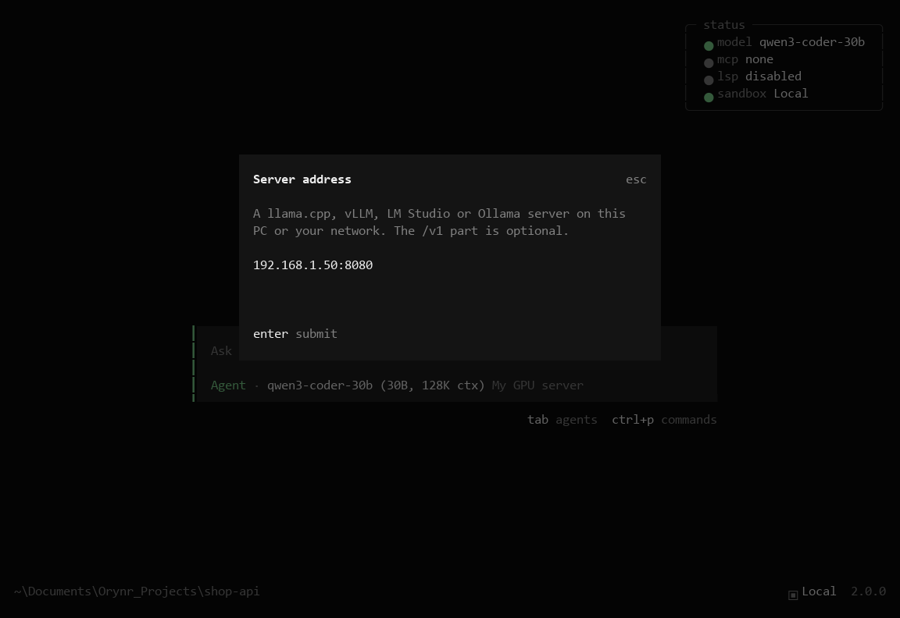
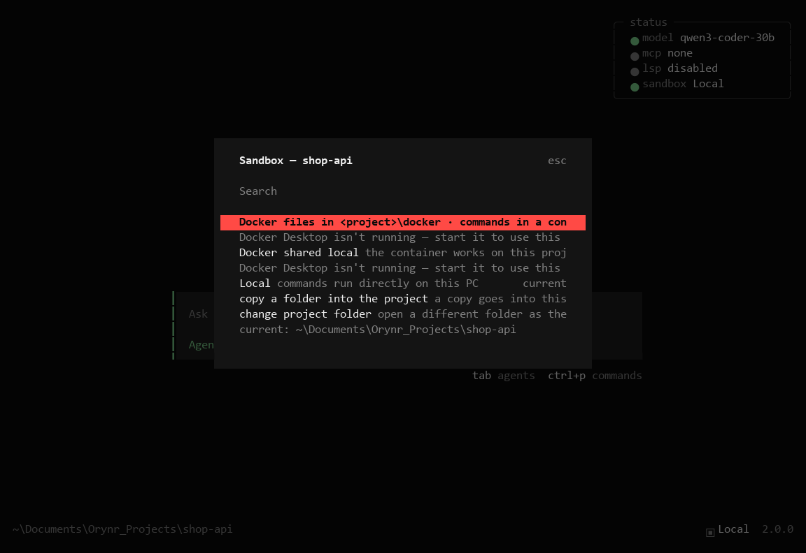
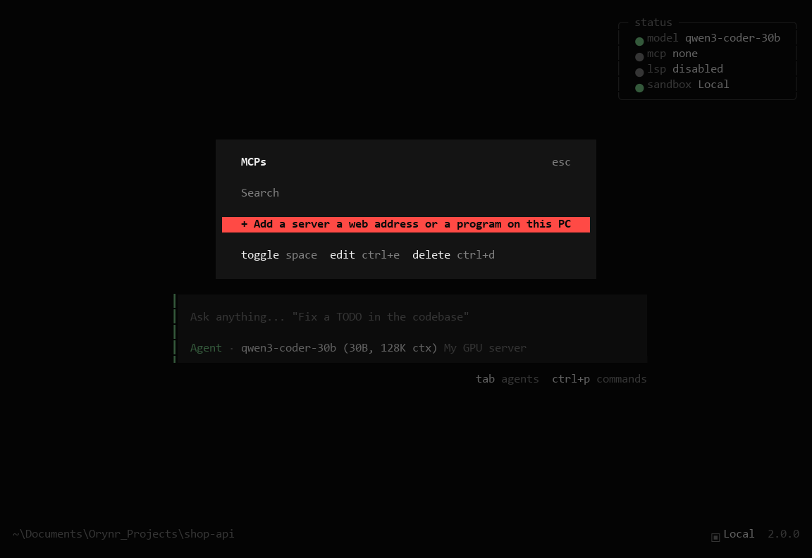

# Orynr Code

**An AI coding agent for your terminal — with your own models or cloud ones.**

Orynr Code plans, writes, runs and checks code with you. It works with a model on your own GPU box (llama.cpp, vLLM,
LM Studio, Ollama), with your **ChatGPT Plus/Pro** account, or with 150+ cloud providers — and it keeps long jobs
going without losing track.

**New in 3.1:** it sees, listens and speaks. Paste a screenshot, have a short video described, talk instead of
type, hear the answer read out, or make an image — each task on its own model, kept on your own machine if you
want. Few terminal coding agents go beyond pasted images; Orynr also handles video, speech in and out, and image
making, and lets every one of them run fully local. Hundreds of skills sit in small groups the model opens only
when needed, so the prompt stays light.

## Download

**Most people:** download **`orynr_code_setup_3.1.1.exe`** from [Releases](../../releases) and run it. It installs
everything it needs and works on any 64-bit Windows PC — no Python, no Node, nothing else to set up.

## What it does

- **A team of agents.** The main *Agent* does the work hands-on; *helpers* take separate parts of a big job and run
  at the same time, each reporting back when done. Specialists for research, code review, risk and security
  audits, and explaining a codebase.
- **A reviewer in the background** keeps a list of what was asked, what was promised and what is still open, so
  nothing quietly gets dropped.
- **Long jobs that fit the model.** Orynr reads your model's real context size from the server and keeps every
  request inside it: older tool results become short notes the model can bring back at any time, and the chat is
  condensed only when it has to be. Nothing is deleted.
- **Switch model mid-task.** Out of cloud quota? Move the chat to your own GPU and carry on — the new model gets a
  light hand-over instead of re-reading everything.
- **Your own model server, first class.** Type an address like `192.0.2.10:8080` and Orynr finds the loaded model,
  its size and context length. Live "reading the conversation" progress while a local model works.
- **Vision and audio.** Images and short videos described by a vision model, screenshots from MCP tools passed
  straight to it, speech-to-text, text-to-speech (wav or ogg) and image making (saved to your Pictures folder).
  Each task can use its own model and server and can be set to local-only or internet.
- **Skills in groups.** Coding, documents, business, design, security and Unreal (editor + engine) — about 200
  skills behind 7 short lines. The model opens a group only when the work needs it; drop your own skill into a
  group folder and it is there at once.
- **Built-in tools** for Excel, Word, PowerPoint, PDF, a browser, network and system checks, databases and more —
  plus MCP servers you add yourself, and Blender and Unreal Engine connections.
- **Safe by default.** Approvals before changes, a project-folder rule, and an optional Docker sandbox with
  internet-only access. Keys are stored encrypted.
- **Plugins.** `/plugins` switches built-in add-ons on or off: *Job-done alert* (a notification when a long job
  finishes or needs you), *Safe mode* (read and make new files only — for family or shared PCs), *Git guard*
  (stops force pushes, `reset --hard`, deleting outside the project) and *Secret shield* (no keys written into
  code, keys hidden from output). Drop your own Python plugin into `%APPDATA%\Orynr\plugins`.
- **Tidy on your PC.** Everything lives in `%APPDATA%\Orynr` and `%LOCALAPPDATA%\Orynr` — nothing in `.config`.
- **Undo, history and project memory** — every change can be undone, and a project remembers what matters.

| Chat | Approvals | Models |
|---|---|---|
|  |  |  |

| Your own server | Sandbox | MCP servers |
|---|---|---|
|  |  |  |

## Connect your ChatGPT Plus/Pro account

1. Start Orynr Code and type **`/connect`**.
2. Choose **OpenAI**, then **ChatGPT Pro/Plus (browser)**.
3. Sign in in the browser window that opens. Done — pick a GPT model with **Ctrl+Alt+O**.

No API key needed; it uses your subscription. Type **`/help`** anytime for every command and shortcut.

## Connect your own model server

Type **`/connect`**, choose **Local or network server**, and enter its address (for example `192.0.2.10:8005`).
Orynr checks the server and tells you plainly if the address, port or key is wrong.

## Run from source

This repo is the complete package: the open frontend (the terminal app in `frontend/`) and the engine it talks to,
shipped compiled in `engine/` (`orynr_server.cp311-win_amd64.pyd`).

You need **Python 3.11** (64-bit) and **[Bun](https://bun.sh)**.

1. `pip install -r engine/requirements.txt`
2. Start the engine: `run_engine.cmd` (it listens on `http://127.0.0.1:4096`).
3. In a second terminal: `cd frontend && bun install`, then `run_tui.cmd`.

The compiled engine is built for Python 3.11 on 64-bit Windows; other Python versions can't load it. The setup
`.exe` has no such limit.

## Licence

- **Frontend** (`frontend/`): MIT — see [LICENSE](LICENSE). Do what you like with it.
- **Engine** (the compiled files): free to use under the [Orynr Code EULA](EULA.txt); not open source.
- Third-party notices: [NOTICE.md](NOTICE.md).
- "Orynr" and the Orynr logo are trademarks of Orynr LLC. The MIT licence covers the code, not the name or logo.

## About

Created by **Sai** ([SKD0007](https://github.com/SKD0007)), founder of **Orynr LLC** — [orynr.com](https://orynr.com)
· info@orynr.com
